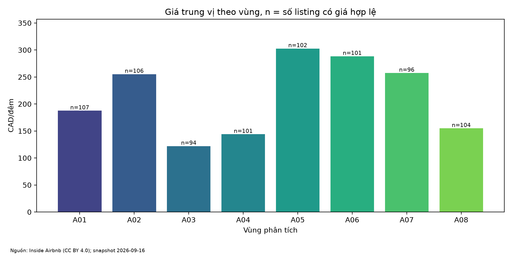
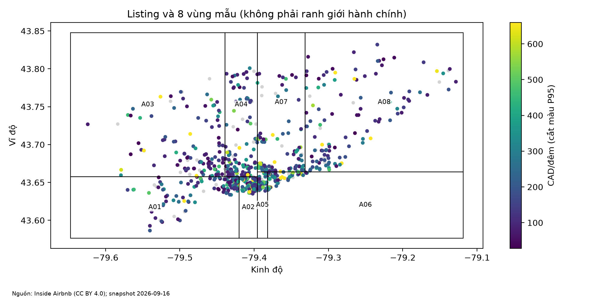

Inside Airbnb - Toronto

BẢN NHÁP - số liệu tự động, nhóm cần viết nhận định

1. Mục tiêu và phạm vi

Bên đặt hàng đề xuất: Cơ quan quản lý du lịch thành phố (giả định, nhóm cần xác nhận). Mục tiêu: mô tả giá, khả dụng và trải nghiệm trong mẫu giảng viên giao.

Nguồn: https://insideairbnb.com/get-the-data/; dữ liệu CC BY 4.0. URL và SHA256 từng file nằm trong download_manifest.csv. Không thu thập airbnb.com.

Snapshot: 2025-09-11, 2026-03-19, 2026-06-15, 2026-09-16. Tiền tệ: CAD.

Snapshot | Listing | Calendar | Review

2025-09-11 | 1,000 | 365,000 | 5,000

2026-03-19 | 1,000 | 365,000 | 5,000

2026-06-15 | 1,000 | 365,000 | 5,000

2026-09-16 | 928 | 338,720 | 4,765

Mốc cuối giữ theo yêu cầu người dùng dù thiếu ID so với danh sách gốc. Danh sách chi tiết: missing_ids.csv. So sánh kỳ dùng mẫu thay đổi, không phải cohort cố định.

Tóm tắt và nhận định: TODO - nhóm tự viết dựa trên các bảng kiểm chứng.

2. Tái lập và kiểm soát chất lượng

Lệnh: python run_pipeline.py --config configs/city.yaml --skip-download --skip-llm. Bỏ --skip-llm để dùng GEMINI_API_KEY từ môi trường. Calendar được lọc theo khối; seed trong config.

QA gắn cờ thiếu dữ liệu, ngoại lai, sai kiểu, danh mục, trùng và nhất quán chéo. KPI trước/sau trong qa_report.csv là tác động giả định loại dòng của từng rule, không phải số dòng thực bị xóa.

Thiếu giá ở mốc cuối: 114 listing. Giá trung vị sau lọc giá bất hợp lý: 210 CAD/đêm.

Quy tắc | Lượt dòng bị cờ (cộng các mốc)

missing_bedrooms | 241

rare_property | 159

missing_review_scores_cleanliness | 121

missing_review_scores_communication | 121

missing_review_scores_checkin | 121

missing_review_scores_accuracy | 121

missing_review_scores_value | 121

missing_review_scores_location | 121

missing_review_scores_rating | 121

Một dòng có thể mang nhiều cờ. Giá listing các mốc trước không dùng trong phân tích. Số review mẫu không được so bằng số review toàn bộ của listing.

TODO - nhóm giải thích và bảo vệ ngưỡng QA; đây là ngưỡng cấu hình đề xuất.

3. KPI và góc nhìn không gian

KPI | Tên | Đơn vị

K1 | Giá đêm trung vị | CAD

K2 | Tỷ lệ ngày không khả dụng theo vùng/mốc | %

K3 | Tỷ lệ ngày không khả dụng theo tháng lịch | %

K4 | Tỷ lệ yêu cầu thuê dài hạn | %

K5 | Tốc độ review trong mẫu | sample reviews/listing/quarter

K6 | Listing chưa có review | %

K7 | Cảm xúc tiêu cực và điểm khía cạnh | % hoặc [-1,1]

K8 | Listing khả dụng cao có nhiều review | %

KPI luôn ghi n. Tám vùng là hình chữ nhật phân tích, không phải địa giới hành chính. TODO - nhóm viết nhận định theo vùng.

4. Không gian và thời gian

Không khả dụng có thể do đã đặt hoặc chủ nhà khóa lịch; không diễn giải thành công suất thực. Các cửa sổ lịch tương lai khác nhau và tháng biên có số ngày khác nhau.

5. LLM, đối chứng và đánh giá

Mẫu hiện tại: 1,000 review duy nhất. Kết quả LLM hợp lệ hiện có: 0. Model cấu hình: gemini-2.5-flash; prompt v1 trong configs/city.yaml (llm.prompt_text).

Gemini trả JSON theo schema, temperature=0, giới hạn tốc độ, retry và cache hash theo ID/văn bản/model/prompt. Cache chỉ có dữ liệu API thật; phần thiếu không được tạo giả.

Đối chứng: langdetect có seed và từ điển cảm xúc đa ngôn ngữ, phủ định ba từ và khía cạnh gần từ cảm xúc. Fallback positive là giả định, không phải lớp đa số đã được chứng minh từ nhãn tay.

CHƯA ĐÁNH GIÁ: chưa có hand_labels.csv thật. Không có accuracy, macro-F1 hoặc kết luận LLM tốt hơn baseline. Nhóm tự gán ít nhất số nhãn yêu cầu trong config.

Kịch bản xử lý toàn bộ 729,202 review thành phố ở mốc cuối: 202.16 USD (không phải chi phí riêng mẫu 1.000). Output giả định/ước lượng 100 token/review. Trạng thái: scenario estimate, not actual spend. Cơ sở token: input chars/4; output scenario assumption from config, NOT measured; thinking/quota may change cost.

Giá tham khảo Standard paid tier: 0.3 USD/triệu token vào, 2.5 USD/triệu token ra; ngày tra: 2026-11-11. Nguồn: https://aistudio.google.com/docs/pricing#gemini-2.5-flash. Đây không phải số tiền đã chi; quota miễn phí khác nhau theo tài khoản.

Tài liệu API: https://ai.google.dev/gemini-api/docs/structured-output. Nhóm tự phân tích lỗi theo error_analysis.csv; không tự gán nguyên nhân mỉa mai bằng máy.

6. Hạn chế, phần còn thiếu và bàn giao

Mẫu được giảng viên chọn, không bảo đảm đại diện toàn thành phố. K5 là review trong mẫu, không phải toàn bộ review mới của thị trường. Không suy luận quốc tịch từ ngôn ngữ review.

Mốc mới có listing/review bị thiếu. Giá thiếu không được điền. Các hình LLM chưa có dữ liệu sẽ được bỏ qua và ghi figure_status.csv.

Việc nhóm cần làm: xác nhận bên đặt hàng và ngưỡng; gán nhãn tay; cung cấp khóa qua môi trường; tra giá model; chạy lại; viết nhận định và phân tích lỗi; kiểm tra định dạng chính thức.

HEAD tại lúc dựng: 1ce34958b73beac375f33f4096f081a8d2e82703. Working tree có thay đổi: True. Đây không phải mã commit của tag final.

Tag final: TODO - người dùng xác nhận việc nộp, commit và tag rồi cập nhật báo cáo. Pipeline không tự push/tag.

TODO - nhóm tự viết kết luận, hướng phát triển và chuẩn bị vấn đáp; mọi số liệu phải đối chiếu summary_numbers.csv.
