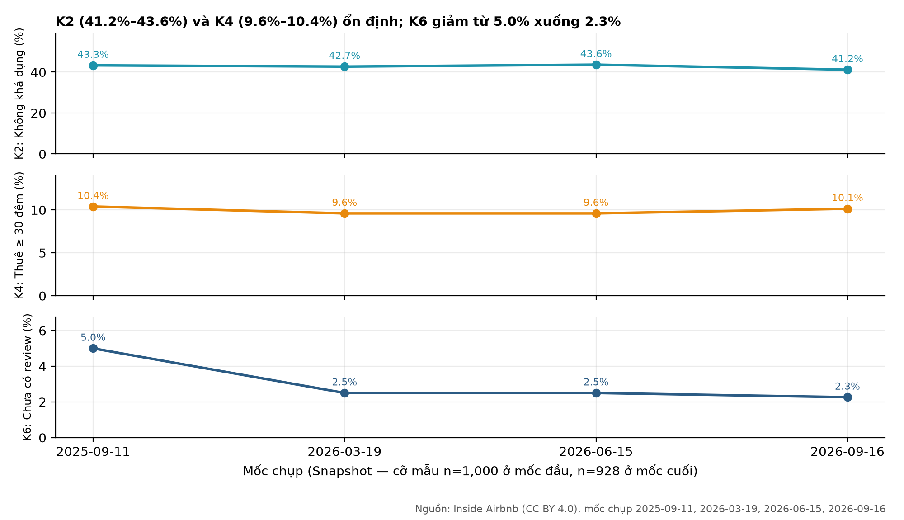
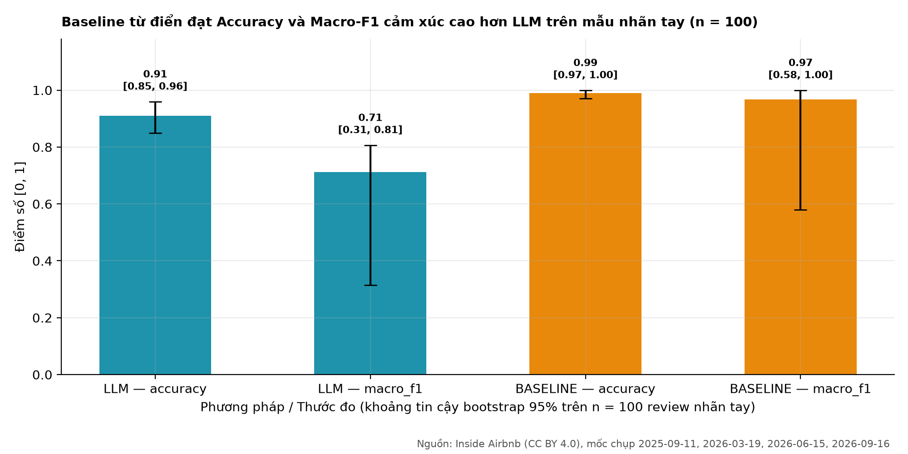

# Báo cáo Phân tích Thị trường Airbnb Toronto (Nhóm 07)

> **Ý chính (Big Idea):** Trong mẫu phân công tại Toronto (mốc 2026-09-16), **86.75%** chỗ ở là loại hình nguyên căn với nguồn cung tập trung dày nhất tại **Waterfront Communities-The Island** (n = 161 chỗ ở có giá hợp lệ, gấp **5.0 lần** khu vực đứng thứ hai là Niagara); mức giá trung vị sau kiểm soát chất lượng đạt **201.07 CAD/đêm** (trên n = 783 chỗ ở có giá hợp lệ).

**Người đọc & mục tiêu quyết định:** Báo cáo hướng tới **Cơ quan quản lý du lịch thành phố Toronto (đã xác nhận bởi nhóm)** nhằm xác định khu vực tập trung nguồn cung cho thuê ngắn hạn, chênh lệch mặt bằng giá, nhịp độ lịch phòng và các điểm mạnh/hạn chế nổi bật trong trải nghiệm lưu trú của khách.

**Giới hạn cần lưu ý ngay từ đầu:** Dữ liệu lấy từ Inside Airbnb (CC BY 4.0, không thu thập trực tiếp từ airbnb.com) trên mẫu được giảng viên phân công qua 4 mốc chụp (2025-09-11, 2026-03-19, 2026-06-15, 2026-09-16), không đại diện toàn bộ thị trường thành phố. Riêng mốc cuối (2026-09-16) giảm **72** chỗ ở và **235** đánh giá so với 3 mốc đầu (chi tiết tại `missing_ids.csv`) do ngừng niêm yết, nên các phép so sánh giữa các kỳ phản ánh mẫu quan sát tại từng mốc, không phải đoàn hệ (cohort) cố định.

## 1. Quy mô mẫu dữ liệu qua 4 mốc chụp

| Mốc chụp (Snapshot) | Listing sau QA | Calendar sau QA | Review sau QA |
| --- | ---: | ---: | ---: |
| 2025-09-11 | 1,000 | 365,000 | 5,000 |
| 2026-03-19 | 1,000 | 365,000 | 5,000 |
| 2026-06-15 | 1,000 | 365,000 | 5,000 |
| 2026-09-16 | 928 | 338,720 | 4,765 |

Ba mốc đầu giữ nguyên đủ **1,000** chỗ ở và **5,000** đánh giá; mốc cuối (2026-09-16) còn **928** chỗ ở. Toàn bộ đường dẫn tải và mã băm SHA256 của 12 tệp nguồn được lưu tại `download_manifest.csv`.

## 2. Nguồn cung tập trung mạnh ở vùng lõi ven hồ và giá nguyên căn cao gấp 2.6 lần phòng riêng

- **Chênh lệch giá theo khu vực (K1):** Trong 12 khu vực hành chính có nhiều chỗ ở nhất tại mốc 2026-09-16, **Niagara** có giá trung vị cao nhất (**336.12 CAD/đêm**, n = 32), gấp **2.6 lần** khu vực thấp nhất trong nhóm là **Dovercourt-Wallace Emerson-Junction** (128.61 CAD/đêm, n = 24). Ba khu vực dẫn đầu về mật độ nguồn cung có giá hợp lệ là **Waterfront Communities-The Island** (n = 161, trung vị 279.17 CAD/đêm), **Niagara** (n = 32, trung vị 336.12 CAD/đêm), **Annex** (n = 30, trung vị 321.67 CAD/đêm).
- **Chênh lệch theo cơ cấu loại phòng:** Tại mốc cuối, giá trung vị của chỗ ở nguyên căn đạt **232.88 CAD/đêm**, cao gấp **2.6 lần** phòng riêng (**90.5 CAD/đêm**). Do cơ cấu loại phòng khác nhau giữa các quận, chênh lệch giá trung vị giữa các khu vực chịu tác động đồng thời của cả vị trí và tỷ trọng nguyên căn, không nên diễn giải đơn thuần là hiệu ứng nhân quả của riêng vị trí.
- **Giới hạn về cỡ mẫu và đơn vị không gian:** Dự án dùng hai cấp độ không gian tách biệt: (1) các KPI từ bảng listing/lịch (K1, K2, K4, K6, K8) nhóm theo khu vực hành chính `neighbourhood_cleansed` — có **118** khu có giá ở mốc cuối nhưng tới **76** khu có n < 5, chưa đủ cỡ mẫu đại diện nên biểu đồ chỉ xếp hạng 12 khu đông nhất; (2) bản đồ phân bố và K7 (LLM) nhóm theo 8 ô phân tích (`analysis_area` A01–A08, mỗi vùng 110–130 listing) để đảm bảo đủ cỡ mẫu văn bản.

*Hình: Giá đêm trung vị (K1) tại 12 khu vực có cỡ mẫu lớn nhất, mốc 2026-09-16.*

[Bản PDF vector](../figures/fig_space_02_area_price.pdf)

*Hình: Phân bố không gian theo trung vị giá (201.07 CAD/đêm) và 8 vùng phân tích A01–A08.*

[Bản PDF vector](../figures/fig_space_01_listings_map.pdf)

## 3. Tỷ lệ ngày không khả dụng ổn định quanh 41.18%–43.62% và luôn cao nhất ở tháng sát mốc chụp

- **Xu hướng khả dụng (K2, K3):** Tỷ lệ ngày không khả dụng toàn mẫu duy trì ổn định trong khoảng **41.18%–43.62%** qua cả 4 mốc chụp. Khi tách theo từng tháng của lịch 365 ngày tới (K3), tỷ lệ không khả dụng luôn cao nhất ở tháng ngay sát ngày thu thập (**57.64%–71.34%**) rồi giảm dần ở các tháng xa hơn trước khi nhích lên vào mùa cao điểm hè–thu.
- **Hoạt động đánh giá theo quý (K5):** Tốc độ đánh giá trong mẫu tăng rõ rệt sau năm 2022 và dao động theo chu kỳ mùa vụ hàng năm.
- **Giới hạn diễn giải bắt buộc:** (1) Ngày `available = f` gộp chung cả ngày đã được khách đặt lẫn ngày chủ nhà chủ động khóa lịch, do đó **không được đồng nhất với công suất thuê phòng thực tế hay doanh thu**; (2) Số đánh giá (K5) không phải tổng lượt khách thuê, chỉ tính trên mẫu review được giao, đồng thời tháng biên/quý cuối chưa trọn vẹn số ngày và thiếu đánh giá từ các chỗ ở đã ngừng niêm yết.

*Hình: Tỷ lệ ngày không khả dụng theo tháng lịch (K3) qua 4 mốc chụp.*

[Bản PDF vector](../figures/fig_time_01_occupancy_by_snapshot.pdf)

*Hình: Xu hướng các chỉ số K2, K4 và K6 qua 4 mốc chụp (tách khung chung trục thời gian).*

[Bản PDF vector](../figures/fig_time_02_kpi_trend.pdf)

## 4. Baseline từ điển vượt LLM về phân loại cảm xúc tổng thể, nhưng LLM vượt trội khi trích xuất khía cạnh khen

Trên toàn bộ **1,000/1,000** đánh giá hợp lệ trích xuất bằng `gemini-3.5-flash-lite` (prompt `v1`, `temperature=0`, lưu đệm JSONL), cảm xúc tích cực chiếm áp đảo (89,7%–95,3%) ở cả 8 vùng phân tích, trong đó **chủ nhà**, **vị trí** và **tiện nghi** là ba khía cạnh được khen nhiều nhất.

| Phương pháp | Thước đo | Giá trị | Khoảng tin cậy 95% | Cỡ mẫu (n) |
| --- | --- | ---: | ---: | ---: |
| LLM | accuracy | 0.9100 | [0.8500, 0.9600] | 100 |
| LLM | macro_f1 | 0.7112 | [0.3139, 0.8070] | 100 |
| BASELINE | accuracy | 0.9900 | [0.9700, 1.0000] | 100 |
| BASELINE | macro_f1 | 0.9679 | [0.5799, 1.0000] | 100 |

*Hình: Đối chứng Accuracy và Macro-F1 cảm xúc giữa LLM và Baseline từ điển (bootstrap 95%).*

[Bản PDF vector](../figures/fig_llm_03_model_vs_baseline.pdf)

- **So sánh định lượng trên 100 nhãn tay (`hand_labels.csv`):** Ở phân loại cảm xúc (`sentiment`), Baseline đạt Accuracy cao hơn LLM một cách có ý nghĩa thống kê (chênh lệch ghép cặp `llm_minus_baseline` = **-0.0800**, 95% CI `[-0.1400, -0.0300]`; LLM lệch **9** ca, Baseline lệch **1** ca). Toàn bộ **9** ca lệch của LLM đều rơi vào ranh giới `mixed_confusion` giữa `positive` và `mixed` khi khách khen tổng thể nhưng kèm một lưu ý nhẹ.
- **Thế mạnh và giới hạn ở bài toán khía cạnh:** Ở trích xuất khía cạnh khen (`aspects_praise`), LLM đạt Micro-F1 = **0.8503**, cao hơn rõ rệt so với **0.6934** của Baseline. Ngược lại, ở khía cạnh bị chê (`aspects_complaint`), do tập nhãn tay chỉ có 7/100 review chứa lời chê và LLM hay gắn nhãn chê cho cả các lưu ý thông tin nhẹ, Micro-F1 của LLM đạt **0.3636** so với **0.5333** của Baseline.
- **Giới hạn cỡ mẫu nhãn tay:** Tập đối chứng 100 review lệch lớp mạnh (93 `positive`, 6 `mixed`, 1 `negative`), khiến khoảng tin cậy 95% của Macro-F1 rất rộng (`[0.3139, 0.8070]` với LLM); cần bổ sung thêm mẫu `negative`/`mixed` trước khi đưa ra kết luận khái quát hơn.

- **Kịch bản chi phí mở rộng toàn thành phố (729,202 đánh giá tại mốc 2026-09-16):** Ước lượng **88.09 USD** (không phải chi phí đã chi cho mẫu 1.000 review; dựa trên mức đầu ra trung bình 39.577 token/review theo `chars/4 from cached results; thinking tokens unknown`, đơn giá tham khảo Standard paid tier 0.3 USD/1M token vào và 2.5 USD/1M token ra, tra ngày 2026-11-11 tại https://ai.google.dev/gemini-api/docs/pricing).

## 5. Thẩm định (Audit) nhận định phân tích theo quy trình 4 bước (Bài 14)

Để tránh các lỗi diễn giải phổ biến khi dùng AI tổng hợp báo cáo (suy diễn nhân quả, chọn sai thước đo, bỏ qua cơ cấu nhóm hoặc diễn đạt quá mức), nhóm áp dụng quy trình 4 bước — **(1) Tính lại số liệu $\rightarrow$ (2) Kiểm tra phương pháp $\rightarrow$ (3) Kiểm tra diễn giải $\rightarrow$ (4) Kết luận: Giữ / Sửa / Chưa đủ căn cứ** — cho 5 nhận định điển hình:

| Nhận định ban đầu cần thẩm định | Số liệu | Phương pháp | Diễn giải | Kết luận & Bản sửa đúng mức |
| --- | --- | --- | --- | --- |
| 1. 86.75% chỗ ở là nguyên căn, chứng tỏ tiềm năng dòng tiền đầu tư lớn. | Đúng | Đúng | Sai: suy diễn doanh thu/dòng tiền từ số lượng listing. | **Sửa:** Mốc 2026-09-16 có 928 chỗ ở trong mẫu, trong đó 86.75% là nguyên căn (không có dữ liệu doanh thu). |
| 2. Giá trung bình (289.01 CAD) cao hơn trung vị (201.07 CAD) chứng minh thị trường siêu sang. | Đúng | Lệch: trung bình bị kéo bởi vài ngoại lai cực đoan. | Quá mức: dùng từ 'chứng minh'. | **Sửa:** Phân phối giá lệch phải; báo cáo dùng trung vị sau lọc IQR (**201.07 CAD/đêm**, n = 783) để phản ánh mức giá điển hình. |
| 3. Tỷ lệ không khả dụng 41.18%–43.62% cho thấy công suất lấp đầy khách luôn vượt 41%. | Đúng | Sai: gộp ngày chủ nhà khóa lịch với ngày đã đặt. | Sai: đồng nhất `available=f` với lượt đặt phòng. | **Chưa đủ căn cứ** kết luận công suất thuê; chỉ ghi nhận tỷ lệ ngày không khả dụng trên lịch. |
| 4. Dovercourt-Wallace Emerson-Junction rẻ hơn Niagara là do kém hấp dẫn về vị trí. | Đúng | Thiếu: chưa kiểm soát cơ cấu loại phòng; 76/118 khu có n < 5. | Sai: suy diễn nhân quả đơn biến. | **Sửa:** Trong 12 khu đông nhất, trung vị giá dao động từ 128.61 đến 336.12 CAD/đêm và chịu ảnh hưởng của tỷ trọng nguyên căn. |
| 5. LLM vượt trội hoàn toàn mô hình từ điển ở mọi tác vụ phân tích đánh giá. | Sai ở `sentiment` | Đúng (đã dùng bootstrap ghép cặp) | Sai: bỏ qua độ lệch lớp và kết quả thua trên cảm xúc. | **Sửa:** Baseline thắng có ý nghĩa thống kê trên cảm xúc tổng thể (Accuracy 0,99 vs 0,91); LLM chỉ vượt trội ở trích xuất khía cạnh khen (Micro-F1 0,85 vs 0,69). |

## 6. Phụ lục phương pháp: Kiểm soát chất lượng (QA), định nghĩa KPI và tái lập

- **Tác động QA lên giá tại mốc cuối (2026-09-16):** Ghi nhận **114** chỗ ở thiếu giá (giữ nguyên NA, không tự điền). Giá trung vị trước lọc ngoại lai là **211.09 CAD/đêm** (trung bình **289.01 CAD/đêm**); sau khi gắn cờ ngoại lai theo quy tắc IQR tính riêng từng `room_type` kết hợp trần `qa.price_max = 2,000 CAD`, giá trung vị hợp lệ đạt **201.07 CAD/đêm** (n = 783).
- **Nguyên tắc QA theo Bài 10:** Tách biệt giá trị thiếu (`missing_price`, `missing_rating`, `missing_minimum_nights`) khỏi lỗi ngoài miền (`invalid_price`, `invalid_rating` ngoài `[0, 5]`, `invalid_minimum_nights`); chỉ gắn cờ (`flag_only`) thay vì xóa dòng để bảo toàn cỡ mẫu cho K2–K8; phân biệt số lượt gắn cờ với số hàng cần kiểm tra (`rows_with_any_flag`).

| Quy tắc QA (top 8 theo tổng 4 mốc) | Tổng lượt/hàng bị gắn cờ |
| --- | ---: |
| review_id_repeated | 29,295 |
| rows_with_any_flag | 4,128 |
| comment_markup | 3,650 |
| missing_price | 213 |
| price_outlier | 169 |
| missing_rating | 121 |
| room_change | 9 |
| missing_minimum_nights | 1 |

| Mã KPI | Tên chỉ số | Đơn vị | Công thức / Điều kiện chính |
| --- | --- | --- | --- |
| K1 | Giá đêm trung vị | CAD/đêm | median(price hợp lệ) |
| K2 | Tỷ lệ ngày không khả dụng theo vùng/mốc | % | 100*(1-mean(available)) |
| K3 | Tỷ lệ ngày không khả dụng theo tháng lịch | % | 100*(1-mean(available)) theo tháng ngày lịch |
| K4 | Tỷ lệ yêu cầu thuê dài hạn | % | 100*mean(minimum_nights>=30) |
| K5 | Tốc độ review trong mẫu | sample reviews/listing/quarter | review duy nhất/quý / listing duy nhất trong mẫu |
| K6 | Listing chưa có review | % | 100*mean(number_of_reviews==0) |
| K7 | Cảm xúc tiêu cực và điểm khía cạnh | % hoặc [-1,1] | negative/valid; (praise-complaint)/(praise+complaint) |
| K8 | Listing khả dụng cao có nhiều review | % | mean(availability>=threshold and reviews>=threshold)*100 |

### Lệnh tái lập và trạng thái bàn giao
- **Chạy toàn bộ pipeline 1 lệnh:** `python run_pipeline.py --config configs/Toronto.yaml` (dùng `--skip-download --skip-llm` khi kiểm thử ngoại tuyến).
- **Kiểm tra tự động:** `pytest` (35 bài test), `check_config_swap.py`, `check_report_numbers.py` (đối chiếu tự động mọi con số trong `report.md` với `summary_numbers.csv`), `check_security.py`.
- **Provenance:** `HEAD` tại lúc xuất báo cáo = `a031947e09ca1957a9c2e211e88bc8eaa0befcee` (`working_tree_dirty = True`, chưa phải mã commit của tag `final`). Pipeline giữ nguyên tắc không tự động `commit`, `tag` hay `push`.
