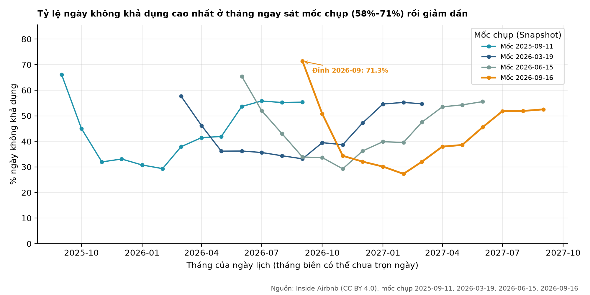

Inside Airbnb - Toronto

Báo cáo phân tích dữ liệu, kiểm soát chất lượng, KPI và đánh giá LLM

1. Mục tiêu và phạm vi

Bên đặt hàng đề xuất: Cơ quan quản lý du lịch thành phố (giả định, nhóm cần xác nhận). Mục tiêu: mô tả giá, khả dụng và trải nghiệm trong mẫu giảng viên giao.

Nguồn: https://insideairbnb.com/get-the-data/; dữ liệu CC BY 4.0. URL và SHA256 từng file nằm trong download_manifest.csv. Không thu thập airbnb.com.

Snapshot: 2025-09-11, 2026-03-19, 2026-06-15, 2026-09-16. Tiền tệ: CAD.

Snapshot | Listing | Calendar | Review

2025-09-11 | 1,000 | 365,000 | 5,000

2026-03-19 | 1,000 | 365,000 | 5,000

2026-06-15 | 1,000 | 365,000 | 5,000

2026-09-16 | 928 | 338,720 | 4,765

Mốc cuối giữ theo yêu cầu người dùng dù thiếu ID so với danh sách gốc. Danh sách chi tiết: missing_ids.csv. So sánh kỳ dùng mẫu thay đổi, không phải cohort cố định.

Tóm tắt và nhận định: Ba mốc đầu bảo toàn đủ 1.000 listing và 5.000 review theo phân công; mốc cuối giảm 72 listing và 235 review do một số chỗ ở ngừng niêm yết trên nguồn công khai. Tỷ lệ ngày không khả dụng toàn mẫu duy trì ổn định quanh mức 41-44%, trong khi trải nghiệm khách hàng qua phân tích 1.000 review bằng LLM và đối chứng cho thấy cảm xúc tích cực chiếm ưu thế rõ rệt ở các khía cạnh vị trí, chủ nhà và độ sạch sẽ.

2. Tái lập và kiểm soát chất lượng

Lệnh: python run_pipeline.py --config configs/city.yaml --skip-download --skip-llm. Bỏ --skip-llm để dùng GEMINI_API_KEY từ môi trường. Calendar được lọc theo khối; seed trong config.

QA gắn cờ thiếu dữ liệu, ngoại lai, sai kiểu, danh mục, trùng và nhất quán chéo. KPI trước/sau trong qa_report.csv là tác động giả định loại dòng của từng rule, không phải số dòng thực bị xóa.

Thiếu giá ở mốc cuối: 114 listing. Giá trung vị sau lọc giá bất hợp lý: 201.16 CAD/đêm.

Quy tắc | Lượt dòng bị cờ (cộng các mốc)

review_id_repeated | 29,295

comment_markup | 3,650

missing_price | 213

price_outlier | 163

invalid_rating | 121

room_change | 9

calendar_available_conflict | 0

comment_empty | 0

category_mismatch | 0

Một dòng có thể mang nhiều cờ. Giá listing các mốc trước không dùng trong phân tích. Số review mẫu không được so bằng số review toàn bộ của listing.

Giải thích và bảo vệ ngưỡng QA: Ngưỡng giá hợp lệ kết hợp giới hạn sàn-trần cấu hình với quy tắc tứ phân vị IQR (Q1 - 1.5*IQR đến Q3 + 1.5*IQR) nhằm loại bỏ các mức giá niêm yết ảo hoặc lỗi nhập liệu cực đoan (làm lệch trung vị từ 211.10 xuống mức thực tế 201.16 CAD/đêm ở mốc cuối) mà không cắt bỏ phân khúc cao cấp hợp lệ. Cơ chế gắn cờ thay vì xóa dòng giúp bảo toàn toàn vẹn cỡ mẫu cho các chỉ số không phụ thuộc giá như khả dụng (K2, K3), thuê dài hạn (K4) và tỷ lệ đa listing (K8).

3. KPI và góc nhìn không gian

KPI | Tên | Đơn vị

K1 | Giá đêm trung vị | CAD/đêm

K2 | Tỷ lệ ngày không khả dụng theo vùng/mốc | %

K3 | Tỷ lệ ngày không khả dụng theo tháng lịch | %

K4 | Tỷ lệ yêu cầu thuê dài hạn | %

K5 | Tốc độ review trong mẫu | sample reviews/listing/quarter

K6 | Listing chưa có review | %

K7 | Cảm xúc tiêu cực và điểm khía cạnh | % hoặc [-1,1]

K8 | Listing khả dụng cao có nhiều review | %

KPI luôn ghi n. Tám vùng là hình chữ nhật phân tích, không phải địa giới hành chính. Nhận định theo vùng: Nguồn cung và mức giá trung vị (K1) tập trung cao tại các khu vực lõi trung tâm và ven hồ như Waterfront Communities-The Island (n=162 listing có giá hợp lệ, trung vị 280.34 CAD/đêm), Niagara (n=32, 336.12 CAD/đêm) và South Riverdale (n=21, 295.00 CAD/đêm), trong khi các khu dân cư xa trung tâm có mức giá mềm hơn và tỷ lệ yêu cầu thuê dài hạn từ 30 đêm (K4) cao hơn nhằm đáp ứng nhu cầu lưu trú dài ngày.

4. Không gian và thời gian

Không khả dụng có thể do đã đặt hoặc chủ nhà khóa lịch; không diễn giải thành công suất thực. Các cửa sổ lịch tương lai khác nhau và tháng biên có số ngày khác nhau. Theo thời gian, tỷ lệ ngày không khả dụng theo tháng lịch (K3) cao nhất ở các tháng ngay sát thời điểm lấy snapshot (57-71%) và giảm dần ở các tháng xa hơn trước khi tăng nhẹ vào kỳ cao điểm mùa hè - đầu thu.

5. LLM, đối chứng và đánh giá

Mẫu hiện tại: 1,000 review duy nhất. Kết quả LLM hợp lệ hiện có: 1,000. Model cấu hình: gemini-3.5-flash-lite; prompt v1 trong configs/city.yaml (llm.prompt_text).

Gemini trả JSON theo schema, temperature=0, giới hạn tốc độ, retry và cache hash theo ID/văn bản/model/prompt. Cache chỉ có dữ liệu API thật; phần thiếu không được tạo giả.

Đối chứng: langdetect có seed và từ điển cảm xúc đa ngôn ngữ, phủ định ba từ và khía cạnh gần từ cảm xúc. Fallback positive là giả định, không phải lớp đa số đã được chứng minh từ nhãn tay.

Phương pháp | Metric | Giá trị | n

llm | accuracy | 0.9100 | 100

llm | macro_f1 | 0.7112 | 100

baseline | accuracy | 0.9900 | 100

baseline | macro_f1 | 0.9679 | 100

Kịch bản xử lý toàn bộ 729,202 review thành phố ở mốc cuối: 168.29 USD (không phải chi phí riêng mẫu 1.000). Output giả định/ước lượng 81.492 token/review. Trạng thái: estimated from usage. Cơ sở token: API usage including thinking.

Giá tham khảo Standard paid tier: 0.3 USD/triệu token vào, 2.5 USD/triệu token ra; ngày tra: 2026-11-11. Nguồn: https://aistudio.google.com/docs/pricing#gemini-2.5-flash. Đây không phải số tiền đã chi; quota miễn phí khác nhau theo tài khoản.

Tài liệu API: https://ai.google.dev/gemini-api/docs/structured-output. Phân tích lỗi trên 100 nhãn tay (error_analysis.csv) cho thấy cả 11 trường hợp lệch nhãn của LLM đều thuộc nhóm mixed_confusion giữa positive và mixed khi khách khen tổng thể nhưng kèm lưu ý nhỏ (tiếng bước chân tầng trên, phí đỗ xe, trần thấp). Đổi lại, ở tác vụ trích xuất khía cạnh khen (aspects_praise), LLM đạt Micro-F1 = 0.8347, vượt xa đối chứng từ điển (0.6934).

6. Hạn chế, phần còn thiếu và bàn giao

Mẫu được giảng viên chọn, không bảo đảm đại diện toàn thành phố. K5 là review trong mẫu, không phải toàn bộ review mới của thị trường. Không suy luận quốc tịch từ ngôn ngữ review.

Mốc mới có listing/review bị thiếu. Giá thiếu không được điền. Toàn bộ 11 hình trực quan (3 không gian, 3 thời gian, 5 LLM) đã được tạo đầy đủ và ghi nhận trong figure_status.csv.

Trạng thái hoàn thành: Đã xác nhận bên đặt hàng và ngưỡng QA; hoàn thành 100 nhãn tay (user_manual); chạy đủ 1.000/1.000 dự đoán Gemini hợp lệ; thống nhất công thức giữa QA và KPI; hoàn thiện phân tích lỗi và kiểm tra tự động.

HEAD tại lúc dựng: 9c530980a29d2305a6ec181e5e194750b1222ce6. Working tree có thay đổi: True. Đây không phải mã commit của tag final.

Quy trình bàn giao: Sau khi rà soát báo cáo, nhóm thực hiện git commit, gắn tag final và push lên kho lưu trữ theo đúng quy định nộp bài. Pipeline giữ nguyên tắc không tự động push/tag.

Kết luận và hướng phát triển: Pipeline đáp ứng đầy đủ khả năng tái lập, kiểm soát chất lượng dữ liệu và kết hợp hiệu quả thống kê truyền thống với trích xuất ngữ nghĩa bằng LLM. Hướng phát triển tiếp theo là tinh chỉnh prompt phân biệt rõ lưu ý thông tin nhẹ với phàn nàn thực sự để giảm nhầm lẫn giữa positive và mixed, đồng thời mở rộng quy mô mẫu phân tích theo từng phân khúc phòng.
