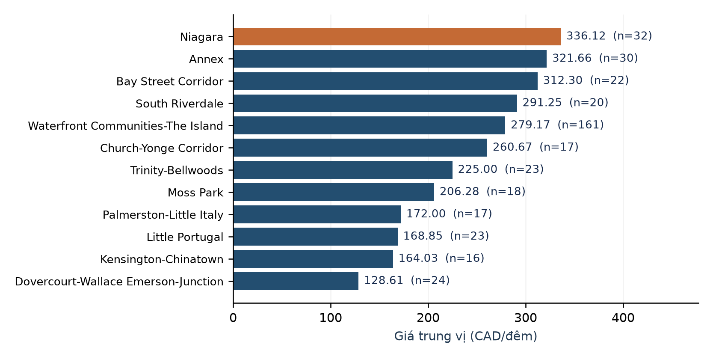
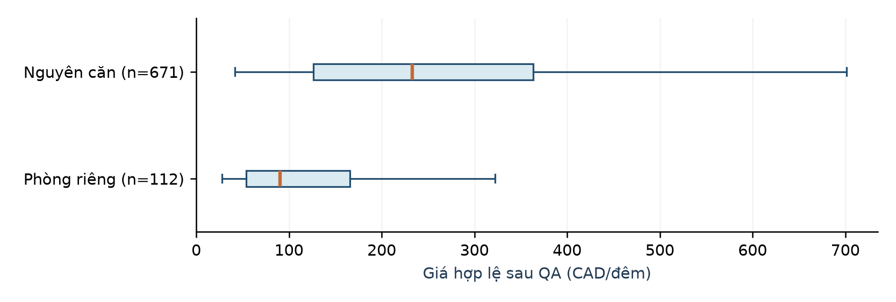
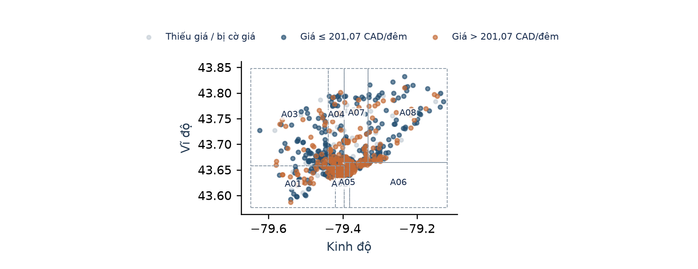
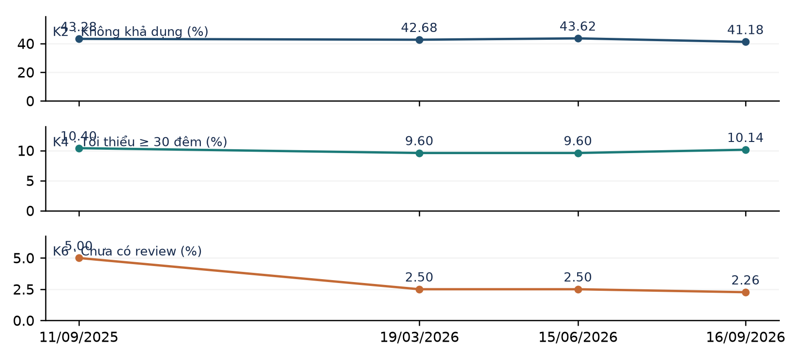
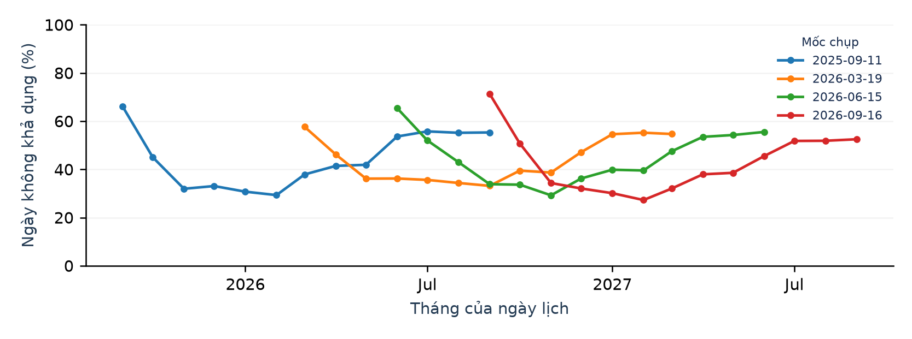
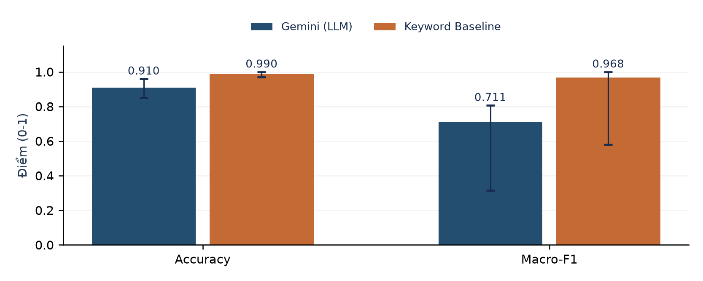
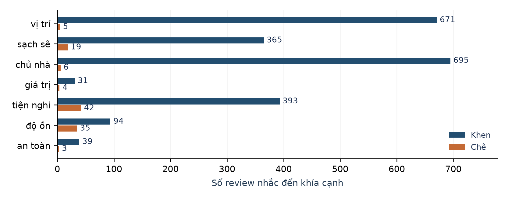

# Phân tích thị trường Airbnb Toronto

**Báo cáo kỹ thuật và kết quả phân tích mẫu phân công**

Nhóm 07 · UET.DSE2049, lớp 4 · Học kỳ 1, năm học 2026-2027

Ngày biên tập: 20/11/2026. Mốc dữ liệu mới nhất: 16/09/2026.

## Tóm tắt điều hành

**Trong mẫu Toronto tại mốc 16/09/2026, nguyên căn chiếm 86,75% số chỗ ở; giá niêm yết trung vị sau QA là 201,07 CAD/đêm trên 783 listing có giá sử dụng được.** Đây là kết quả mô tả mẫu được phân công, không phải ước lượng đại diện cho toàn thành phố.

Báo cáo phục vụ Cơ quan quản lý du lịch thành phố Toronto theo bên liên quan mà nhóm đã ghi trong cấu hình. Ba câu hỏi chính là: nguồn cung trong mẫu tập trung ở đâu; mức giá và lịch khả dụng khác nhau ra sao; phân tích review bằng LLM đáng tin đến mức nào so với một phương pháp đơn giản.

| Phát hiện chính | Bằng chứng và giới hạn |
| --- | --- |
| Nguồn cung trong mẫu tập trung tại Waterfront Communities-The Island | Khu vực có 193/928 listing, tương đương 20,80%; riêng số listing có giá hợp lệ là 161. Không dùng 161 để đại diện toàn bộ nguồn cung khu vực. |
| Giá nguyên căn cao hơn phòng riêng | Trung vị lần lượt là 232,88 và 90,50 CAD/đêm, chênh khoảng 2,57 lần. Hai phân phối vẫn có phần chồng lấn; chưa tách riêng ảnh hưởng vị trí, sức chứa hoặc tiện nghi. |
| Ngày không khả dụng chiếm 41,18-43,62% qua các mốc | Đây là trạng thái lịch, gộp ngày đã đặt và ngày chủ nhà khóa lịch; không phải công suất thuê thực tế. |
| Keyword Baseline thắng về sentiment, LLM tốt hơn ở khía cạnh khen | Trên cùng 100 nhãn tham chiếu, accuracy là 0,99 so với 0,91; micro-F1 khía cạnh khen là 0,6934 so với 0,8503. Kết quả chưa đủ để khái quát thứ hạng mô hình ra ngoài mẫu. |

## Phạm vi sử dụng kết quả

Mốc cuối còn 928 listing và 4.765 review, ít hơn danh sách phân công lần lượt 72 và 235 bản ghi. Không tìm thấy các ID này trong mốc nguồn đang dùng; dữ liệu hiện có chưa chứng minh nguyên nhân là ngừng niêm yết. So sánh theo thời gian sử dụng thành phần mẫu tại từng mốc, không phải một đoàn hệ listing cố định.

Các kết quả thích hợp để xác định nội dung cần khảo sát thêm, như khu vực tập trung listing, khác biệt giá và ranh giới nhãn cảm xúc. Chưa có cơ sở để suy ra doanh thu, tác động của Airbnb tới nhà ở, hoặc quan hệ nhân quả giữa vị trí và giá.

<!-- page -->

## 1. Dữ liệu và kiểm soát chất lượng

### 1.1. Bốn lần quan sát và đơn vị phân tích

Nguồn dữ liệu là Inside Airbnb, giấy phép CC BY 4.0 [1]. Mỗi dòng listings biểu diễn một chỗ ở tại một mốc; calendar biểu diễn một ngày lịch của một chỗ ở; reviews biểu diễn một phản hồi. Dữ liệu được lọc theo ID phân công trước khi QA.

| Mốc chụp theo cấu hình | Listing sau QA | Ngày lịch sau QA | Review sau QA |
| --- | ---: | ---: | ---: |
| 2025-09-11 | 1.000 | 365.000 | 5.000 |
| 2026-03-19 | 1.000 | 365.000 | 5.000 |
| 2026-06-15 | 1.000 | 365.000 | 5.000 |
| 2026-09-16 | 928 | 338.720 | 4.765 |

Mốc chụp là nhãn thư mục nguồn; ngày scrape thực tế có thể khác. Ví dụ, listings của mốc 2026-09-16 ghi ngày scrape 17-18/09/2026. Manifest lưu URL và SHA256 của 12 tệp bảng nguồn, giúp đối chiếu đúng phiên bản dữ liệu.

**Đối chiếu phạm vi bài nộp:** đề gốc [2] chỉ định Toronto gồm cả 2025-11-11. Cấu hình hiện tại dùng 2026-09-16 thay mốc này và có ghi ngoại lệ trong decisions.snapshot_exception. Báo cáo phản ánh đúng bộ dữ liệu đang có; việc đáp ứng yêu cầu bốn mốc gốc cần nhóm đối chiếu lại với giảng viên.

### 1.2. Gắn cờ để giữ đúng mẫu số cho từng KPI

QA kiểm tra giá trị thiếu, kiểu dữ liệu, danh mục, miền giá trị, bản ghi trùng, liên kết ID và thay đổi giữa các mốc. Quy tắc phân biệt giá thiếu với giá ngoài miền; các cờ được giữ để một listing thiếu giá vẫn tham gia chỉ số không phụ thuộc giá. Review được làm sạch markup trước khi trích xuất văn bản.

| Trạng thái giá tại 2026-09-16 | Số listing | Xử lý trong phân tích giá |
| --- | ---: | --- |
| Thiếu giá | 114 | Giữ NA; không điền và không tính K1 |
| Có giá nhưng bị cờ ngoại lai | 31 | Giữ listing; loại giá khỏi K1 |
| Giá sử dụng được | 783 | Tính trung vị và các so sánh giá |
| Tổng mẫu | 928 | Giữ cho các chỉ số có đầu vào hợp lệ |

Quy tắc giá kết hợp trần 2.000 CAD với khoảng IQR tính theo từng room_type. Trung vị trước loại giá bị cờ là 211,095 CAD/đêm; sau lọc còn 201,07 CAD/đêm. Số dòng listing vẫn là 928. Ngưỡng này là lựa chọn phân tích của nhóm, không chứng minh mọi giá bị cờ đều là lỗi; nó có thể loại cả giá cao có thật.

Nguồn đối chiếu: listings_clean.csv theo mốc, qa_report.csv, missing_ids.csv và download_manifest.csv. Số lỗi chồng lấn không được cộng thành số dòng đã xóa.

<!-- page -->

## 2. Nguồn cung và giá khác nhau theo khu vực

### 2.1. Waterfront dẫn đầu số listing trong mẫu

| Neighbourhood tại 2026-09-16 | Toàn bộ listing | Có giá hợp lệ | Giá trung vị (CAD/đêm) |
| --- | ---: | ---: | ---: |
| Waterfront Communities-The Island | 193 | 161 | 279,17 |
| Niagara | 38 | 32 | 336,12 |
| Annex | 35 | 30 | 321,67 |

Waterfront có khoảng 5,08 lần số listing của Niagara trong mẫu. Bảng phân biệt quy mô nguồn cung với độ phủ giá: giá Waterfront được tính trên 161 listing, không phải toàn bộ 193 listing. Đây là số lượng quan sát, không phải mật độ theo diện tích.

### 2.2. Niagara có giá cao nhất trong nhóm 12 khu vực đủ mẫu lớn nhất



*Hình 1. Nguồn: kpi_area.csv, K1, mốc 2026-09-16. Các khu vực được chọn theo n giá hợp lệ rồi xếp theo giá; n không phải tổng listing của khu vực. Trục giá bắt đầu từ 0.*

Trong nhóm này, Niagara đạt 336,12 CAD/đêm (n=32), cao khoảng 2,61 lần Dovercourt-Wallace Emerson-Junction, 128,61 CAD/đêm (n=24). Xếp hạng không bao gồm tất cả neighbourhood và không phản ánh giá giao dịch đã thanh toán.

Tại mốc cuối, 118 neighbourhood có ít nhất một giá hợp lệ; 76 khu vực trong số đó có dưới 5 quan sát. Vì vậy, báo cáo giới hạn biểu đồ ở 12 khu vực có mẫu giá lớn nhất. Một cỡ mẫu lớn hơn giúp mô tả ổn định hơn nhưng không tự làm mẫu phân công trở nên đại diện.

**Hàm ý khảo sát:** Waterfront là nơi có nhiều listing nhất để ưu tiên kiểm tra trong mẫu. Khi giải thích chênh lệch giá, cần phân tầng thêm theo loại phòng và sức chứa trước khi gán khác biệt cho vị trí.

<!-- page -->

## 3. Cơ cấu loại phòng ảnh hưởng cách đọc mặt bằng giá

| Loại phòng tại 2026-09-16 | Số listing | Tỷ trọng mẫu | Giá hợp lệ (n) | Trung vị (CAD/đêm) |
| --- | ---: | ---: | ---: | ---: |
| Nguyên căn (Entire home/apt) | 805 | 86,75% | 671 | 232,88 |
| Phòng riêng (Private room) | 123 | 13,25% | 112 | 90,50 |



*Hình 2. Nguồn: listings_clean.csv, mốc 2026-09-16; chỉ giá hợp lệ sau QA. Hộp là Q1-Q3, đường cam là trung vị; râu theo quy tắc 1,5×IQR. Các điểm ngoài râu được ẩn khi vẽ, không bị xóa thêm khỏi phép tính.*

Trung vị nguyên căn gấp 2,57 lần phòng riêng. Sự chồng lấn của các phân phối cho thấy không thể khẳng định mọi nguyên căn đều đắt hơn mọi phòng riêng. Đây là so sánh hai nhóm có cơ cấu vị trí, tiện nghi và sức chứa khác nhau.



*Hình 3. Nguồn: listings_clean.csv và areas.csv; 928 listing tại 2026-09-16. Màu phân biệt giá với trung vị 201,07 CAD/đêm; xám là thiếu giá hoặc bị cờ. Tọa độ không phải địa chỉ chính xác.*

Các khung A01-A08 là ô analysis_area do phân công, không phải ranh giới hành chính. Ở mốc cuối, mỗi ô có 110-120 listing. KPI địa bàn dùng neighbourhood_cleansed, còn thống kê văn bản theo ô dùng analysis_area; hai cấp này không được ghép hoặc gọi thay cho nhau. Biểu đồ tọa độ hỗ trợ xem phân bố điểm, chưa đo mật độ hoặc tác động của khoảng cách.

<!-- page -->

## 4. Lịch không khả dụng giữ trong khoảng 41,18-43,62%



*Hình 4. Nguồn: kpi_time.csv. Các khung dùng chung ngày thực và trục tung bắt đầu từ 0, nhưng có giới hạn trục khác nhau; không so độ dốc giữa các khung. K2 có mẫu số ngày lịch; K4/K6 có mẫu số listing.*

K2 giảm từ 43,28% ở mốc đầu xuống 41,18% ở mốc cuối; mốc cao nhất là 43,62%. K4, tỷ lệ yêu cầu tối thiểu 30 đêm, nằm trong khoảng 9,60-10,40%. K6, tỷ lệ listing chưa có review, từ 5,00% xuống 2,26%. Mốc cuối dùng 927 listing có minimum_nights hợp lệ cho K4 và 928 listing cho K6; các thay đổi chưa được kiểm tra trên đoàn hệ cố định.



*Hình 5. Nguồn: kpi_time.csv, K3. Calendar quan sát lịch tương lai tại mỗi snapshot. Tháng biên có thể chưa đủ ngày; cùng một tháng lịch có thể có kết quả khác nhau ở các lần scrape.*

Trong bốn lần quan sát, tháng sát mốc chụp có tỷ lệ không khả dụng cao nhất, từ 57,64% đến 71,34%. Điều này có thể gắn với khoảng cách tới ngày lưu trú, cách chủ nhà mở lịch hoặc đặt phòng; dữ liệu không tách được các cơ chế đó. Bốn snapshot chưa đủ để khẳng định quy luật mùa vụ.

K5 chỉ đếm review duy nhất trong mẫu theo quý trên 1.000 listing ID duy nhất của tập gộp. Review không phải lượt khách thuê; việc thay đổi tập listing còn xuất hiện và các quý chưa trọn vẹn hạn chế so sánh tăng trưởng.

<!-- page -->

## 5. Keyword Baseline đạt sentiment tốt hơn trên bộ nhãn tham chiếu

### 5.1. Hai phương pháp được chấm với cùng một đáp án

Mẫu LLM gồm 1.000 review theo cờ phân công; mỗi ID giữ bản văn bản đã QA mới nhất. Tệp dự đoán ghi 1.000 kết quả hợp lệ, model gemini-3.5-flash-lite, prompt v1. Cache ghi các kết quả ngày 12/11/2026. Mã gọi API đặt temperature=0, yêu cầu JSON gồm sentiment, khía cạnh khen/chê và ngôn ngữ. Báo cáo đọc kết quả đã lưu, không gọi lại API.

**Keyword Baseline** là mã từ điển, không phải người gán nhãn. Nó đếm từ tích cực/tiêu cực, xử lý phủ định và từ chuyển ý, mặc định positive khi không có tín hiệu phù hợp. **Gold labels** là 100 nhãn tham chiếu do nhóm cung cấp; chúng là đáp án để chấm cả Gemini lẫn baseline.

| Phương pháp | Accuracy | Macro-F1 | CI 95% của accuracy | CI 95% của macro-F1 |
| --- | ---: | ---: | --- | --- |
| Gemini (LLM) | 0,9100 | 0,7112 | [0,8500; 0,9600] | [0,3139; 0,8070] |
| Keyword Baseline | 0,9900 | 0,9679 | [0,9700; 1,0000] | [0,5799; 1,0000] |



*Hình 6. Nguồn: eval_metrics.csv; đường đen là khoảng tin cậy bootstrap 95%. Nhãn tay là chuẩn tham chiếu, không phải cột mô hình thứ ba. Macro-F1 là trung bình F1 từng lớp, không phải F1 tính từ precision/recall đã lấy trung bình.*

### 5.2. Chín lỗi của Gemini tập trung ở ranh giới positive/mixed

Tập nhãn gồm 93 positive, 6 mixed và 1 negative. Gemini đúng 89/93 positive, 1/6 mixed, 1/1 negative; baseline đúng tương ứng 93/93, 5/6 và 1/1. Không thể suy ra khả năng nhận diện negative nói chung từ một trường hợp.

Chênh lệch accuracy ghép cặp LLM trừ baseline là -0,08, với CI 95% [-0,14; -0,03]. Khoảng này không chứa 0 trong phép bootstrap theo review đang dùng. Tuy nhiên, 100 review thuộc 87 listing; phép bootstrap chưa điều chỉnh sự phụ thuộc theo listing. Lịch sử chốt prompt, từ điển và nhãn chưa đủ để xác nhận một holdout độc lập. Kết luận chỉ áp dụng cho bộ tham chiếu hiện tại.

<!-- page -->

## 6. LLM hữu ích hơn ở khía cạnh khen, cần thận trọng với lời chê



*Hình 7. Nguồn: llm_results.parquet. Một review có thể nhắc nhiều khía cạnh; các số đếm không cộng thành 1.000. Đây là nhãn dự đoán trong mẫu, không phải thống kê đã được con người kiểm chứng toàn bộ.*

Chủ nhà (695 review), vị trí (671) và tiện nghi (393) là ba khía cạnh được khen nhiều nhất theo dự đoán LLM. Tiện nghi (42) và độ ồn (35) được nhắc trong lời chê nhiều nhất. Tỷ lệ positive theo tám ô phân tích từ 89,72% đến 95,33%; không suy rộng các tỷ lệ này cho toàn Toronto.

| Tác vụ khía cạnh trên cùng 100 nhãn tham chiếu | Gemini micro-F1 | Keyword Baseline micro-F1 |
| --- | ---: | ---: |
| Trích xuất khía cạnh khen | 0,8503 | 0,6934 |
| Trích xuất khía cạnh chê | 0,3636 | 0,5333 |

Chỉ 7/100 review tham chiếu có khía cạnh chê. Vì thế, kết quả chê nhạy với vài quyết định gán nhãn. Mẫu lỗi cho thấy ranh giới giữa thông tin lưu ý và phàn nàn cần được quy định rõ; đây là giả thuyết để cải thiện rubric, chưa phải bằng chứng rằng một phương pháp hiểu ngữ cảnh tốt hơn trong mọi trường hợp.

### Kịch bản chi phí mở rộng, không phải chi phí thực chi

| Tham số lưu trong llm_cost_estimate.csv | Giá trị |
| --- | ---: |
| Tổng review thành phố tại mốc cuối, không cộng các snapshot | 729.202 |
| Token vào / review, ước lượng | 72,88325 |
| Token ra / review, ước lượng | 39,577 |
| Giá kịch bản / một triệu token vào và ra | 0,30 và 2,50 USD |
| Tổng chi phí kịch bản | 88,09 USD |

Tính theo: 729.202 × (72,88325 × 0,30 + 39,577 × 2,50) / 1.000.000. Token được ước từ ký tự/4; thinking token chưa xác định. Giá lưu ngày 11/11/2026 chưa được xác minh lại là biểu phí phù hợp với model lúc chạy báo cáo. Con số 88,09 USD là kịch bản theo tham số của repo, không phải báo giá hiện tại, hóa đơn hay chi phí đã chi cho mẫu 1.000 review.

<!-- page -->

## 7. Thẩm định nhận định và kết luận đúng phạm vi

Nhóm áp dụng bốn bước của Bài 14: tính lại số liệu, kiểm tra phương pháp, kiểm tra diễn giải, rồi quyết định giữ, sửa hoặc chưa đủ căn cứ. Bảng dưới là các nhận định cần phản biện, không phải các phát hiện được chấp nhận nguyên văn.

| Nhận định cần thẩm định | Kiểm tra số liệu và phương pháp | Kết luận / diễn đạt có căn cứ |
| --- | --- | --- |
| “86,75% là nguyên căn nên tiềm năng dòng tiền lớn.” | Tỷ trọng đúng trên 805/928 listing; không có doanh thu thực. | Sửa: nguyên căn chiếm 86,75% mẫu ở mốc cuối. Không kết luận dòng tiền. |
| “Trung bình 289,01 CAD chứng minh phân khúc siêu sang.” | Trung bình trước lọc không cùng tập quan sát với trung vị sau lọc; giá cao có thể có thật. | Sửa: báo cáo trung vị 201,07 CAD trên 783 giá sau QA và mô tả rõ lựa chọn ngưỡng. |
| “Không khả dụng trên 41% nghĩa là lấp đầy trên 41%.” | available=f không phân biệt booking và chủ nhà khóa lịch. | Chưa đủ căn cứ về công suất thuê; chỉ báo cáo trạng thái lịch quan sát được. |
| “Niagara đắt hơn Dovercourt vì vị trí hấp dẫn hơn.” | So sánh giá có mẫu số rõ, nhưng chưa kiểm soát loại phòng, sức chứa hoặc tiện nghi. | Sửa: chênh 2,61 lần trong nhóm 12 khu được chọn; chưa xác định nguyên nhân. |
| “LLM tốt hơn baseline ở mọi tác vụ.” | Accuracy sentiment 0,91 < 0,99; micro-F1 khen 0,8503 > 0,6934. | Sửa: thứ hạng thay đổi theo tác vụ, trên bộ nhãn tham chiếu đang dùng. |

### Kết luận cho bên liên quan

Trong mẫu, Waterfront có nhiều listing nhất và nguyên căn chiếm ưu thế. Giá trung vị có thể hỗ trợ mô tả mặt bằng niêm yết, nhưng phân tích địa bàn cần đi kèm độ phủ giá và cơ cấu loại phòng. Trạng thái lịch phản ánh mức mở/khóa quan sát được, không đo doanh thu hay lượng khách thực tế.

Với review, giữ cả Keyword Baseline và Gemini làm hai phương pháp tham chiếu. Ưu tiên cải thiện hướng dẫn positive/mixed, gán nhãn mù với dự đoán trên một bộ mới và bổ sung negative/mixed trước khi đánh giá lại. Không điều chỉnh nhãn chỉ để làm tăng điểm của một phương pháp.

### Giới hạn còn lại

Mẫu phân công không có xác suất chọn đã biết; một số ID thiếu ở mốc cuối. Cỡ mẫu giá nhỏ tại nhiều neighbourhood và QA có thể loại một phần giá cao hợp lệ. Review ở các snapshot lặp lại được xử lý theo ID cho K5/LLM; dữ liệu lịch sử còn phụ thuộc listing hiện diện. Ngoại lệ mốc chụp, tính độc lập của gold, độ phụ thuộc theo listing và biểu phí API cần được kiểm chứng thêm khi hoàn thiện bàn giao.

<!-- page -->

## 8. Phụ lục phương pháp, tái lập và nguồn

### 8.1. Tám KPI và mẫu số tương ứng

| KPI | Chỉ số / công thức | Điều kiện và đơn vị |
| --- | --- | --- |
| K1 | Median giá niêm yết hợp lệ tại mốc cuối | Giá dương, không bị cờ ngoại lai; CAD/đêm; n giá hợp lệ |
| K2 | 100 × (1 - mean(available)) theo mốc/khu vực | Ngày lịch có available hợp lệ; % ngày |
| K3 | Công thức K2 theo tháng của ngày lịch và snapshot | Cửa sổ lịch tương lai; lưu ý tháng biên; % ngày |
| K4 | 100 × mean(minimum_nights ≥ 30) | Listing có minimum_nights hợp lệ; % listing |
| K5 | Review ID duy nhất/quý ÷ listing ID duy nhất của tập gộp | Review có ngày hợp lệ; review mẫu/listing/quý |
| K6 | 100 × mean(number_of_reviews = 0) | Listing sau QA; % listing |
| K7 | 100 × negative/valid; (khen - chê)/(khen + chê) | Review LLM hợp lệ theo analysis_area; % hoặc [-1;1] |
| K8 | 100 × mean(khả dụng ≥ 0,75 và số review ≥ 10) | Listing có lịch/review hợp lệ; % listing; không gọi là “chuyên nghiệp” |

Với K7, khen+chê bằng 0 thì điểm khía cạnh không xác định. K1/K2/K4/K6/K8 dùng neighbourhood_cleansed; K7 dùng tám ô analysis_area. Tệp kpi_definitions.csv mô tả mục tiêu và bộ lọc đầy đủ.

### 8.2. Tái lập và kiểm tra đã thực hiện

Quy trình chính đọc thành phố, mốc và ngưỡng từ configs/city.yaml. API key lấy từ GEMINI_API_KEY. Chế độ skip-llm dùng kết quả lưu hợp lệ, không chứng minh đã gọi lại API.

```bash
python run_pipeline.py --config configs/city.yaml
python run_pipeline.py --config configs/city.yaml --skip-download --skip-llm
python -m pytest -c notebooks/pytest.ini -q
```

Lần biên tập này chạy lại bộ kiểm thử hiện có: **34 passed**. Đồng thời đối chiếu K1 từ giá từng listing, tính lại accuracy/macro-F1 từ dự đoán và gold, kiểm tra 114+31+783=928. Không tải lại raw và không gọi API trong lần dựng báo cáo này. Chưa xác nhận một lần chạy sạch toàn pipeline với khóa API mới.

Commit nguồn: **b166756** (Clarify QA price cap configuration in current codebase); bản báo cáo biên tập ngày 20/11/2026, chưa phải commit/tag final. Markdown nguồn là reports/report_professional.md; tài liệu AI của nhóm là AI_USAGE.md. Các hình trong bản này được vẽ lại từ dữ liệu đã lưu, không thay số liệu đầu vào.

### 8.3. Nguồn và tài liệu tham khảo

[1] Inside Airbnb. [Get the Data](https://insideairbnb.com/get-the-data/) và [Data Assumptions](https://insideairbnb.com/data-assumptions/). CC BY 4.0; URL/SHA256 cụ thể theo download_manifest.csv.

[2] UET.DSE2049. [Đề bài Inside Airbnb, học kỳ 1 năm 2026-2027](https://courses.iaidev.com/programming-for-data-processing/2627-1/projects/project_airbnb.html). Đối chiếu ngày 20/11/2026.

[3] UET.DSE2049. [Bài 12: Trực quan hoá cơ bản](https://courses.iaidev.com/programming-for-data-processing/2627-1/lecture-12-truc-quan-hoa-co-ban.html); [Bài 13: Trực quan hoá nâng cao](https://courses.iaidev.com/programming-for-data-processing/2627-1/lecture-13-truc-quan-hoa-nang-cao.html); [Bài 14: Kể chuyện bằng dữ liệu](https://courses.iaidev.com/programming-for-data-processing/2627-1/lecture-14-ke-chuyen-bang-du-lieu.html).

[4] [Kho nguồn Nhóm 07](https://github.com/nguyenvh2201-lgtm/2627-LTXLDL-Airbnb-Nhom07): các bảng sạch, KPI, dự đoán LLM/baseline, gold labels, eval_metrics.csv, confusion_matrices.csv, qa_report.csv và llm_cost_estimate.csv tại commit b166756.
